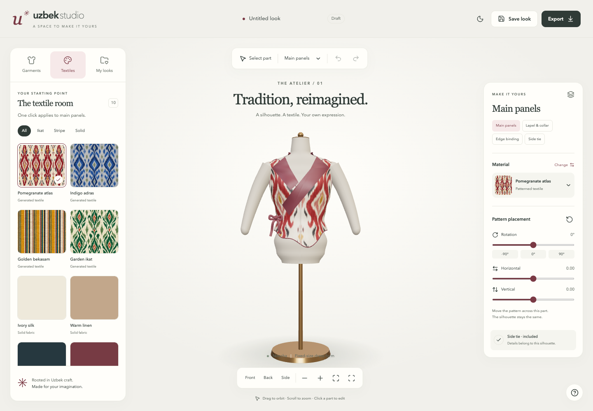

# Uzbek Studio

*Last updated: 2026-09-25*

A 3D creative studio for exploring Uzbek clothing on a mannequin with selectable garment parts and editable fabric placement.

## State

The repository contains a running browser studio with one fixed mannequin and five authored garment interpretations:
`nimcha`, `baska`, `kostyum`, `korset`, and `abaya`. Each garment declares its own editable parts and
built-in details. Four generated textile studies and six solid materials support per-part rotation and U/V placement
in degrees and normalized offsets.

Looks persist in local browser storage and can be saved as independent copies, reopened, exported as portable JSON,
or captured as PNG previews. The responsive editor uses floating island controls around a WebGL canvas.
Current check results and remaining manual validation are recorded in
[verification](engineering/planning/verification.md).



## Start

Requires Git LFS, .NET 10 SDK, Node 24, npm 11.6.1, and a WebGL-capable browser.

Large generated PNG textures are stored through Git LFS. After cloning:

```sh
git lfs install
git lfs pull
```

Build and run the single host:

```sh
dotnet build engineering/codebase/uzbek-studio.backend-services/UzbekStudio.BackendServices.slnx
dotnet test engineering/codebase/uzbek-studio.backend-services/UzbekStudio.BackendServices.slnx --no-build
dotnet run --project engineering/codebase/uzbek-studio.backend-services/UzbekStudio.Api --no-build --launch-profile https
```

The backend build installs the locked frontend dependencies and builds the SPA into its generated `wwwroot/`.

For frontend work, run these commands from `engineering/codebase/uzbek-studio.frontend-services/`:

```sh
npm ci
npm run typecheck
npm test
npm run build
npm run dev
```

Normal development uses HTTPS at `https://localhost:8262` and proxies the API at `https://localhost:8260`.
The backend also binds `http://localhost:8261`. Accept native certificate setup only through the user-controlled trust prompt.
The explicit `npm run dev-http` profile is available for headless previews.

Browser tests use `npm run test:e2e`; install the configured Playwright browser first when the machine does not have it.

## Layout

- `product/`: requirements, user flows, and product scope.
- `engineering/codebase/uzbek-studio.backend-services/`: .NET API, Application, Domain, and test projects.
- `engineering/codebase/uzbek-studio.frontend-services/`: React, TypeScript, and Vite.
- `engineering/architecture/`: implemented studio, state, persistence, and asset contracts.
- `engineering/planning/`: current backlog, archived foundation brief, and verification.

The backend exposes studio capability information at `GET /api/studio`; the template greeting and database projects
have been removed.

## Boundaries

Garment assets are authored visual interpretations, not exact catalogue replicas. The app does not simulate cloth,
prove fit, resize garments, or generate sewing patterns. Persistence is browser-local: there are no accounts,
cloud storage, or collaborative editing. No source catalogue media or secrets are copied into this repository.

## Continue

- [Studio requirements](product/features/studio.md)
- [Archived implementation prompt](engineering/planning/implementation-prompt.md)
- [Verification record](engineering/planning/verification.md)
- [Asset reference provenance](engineering/research/catalogue-evidence.md)
